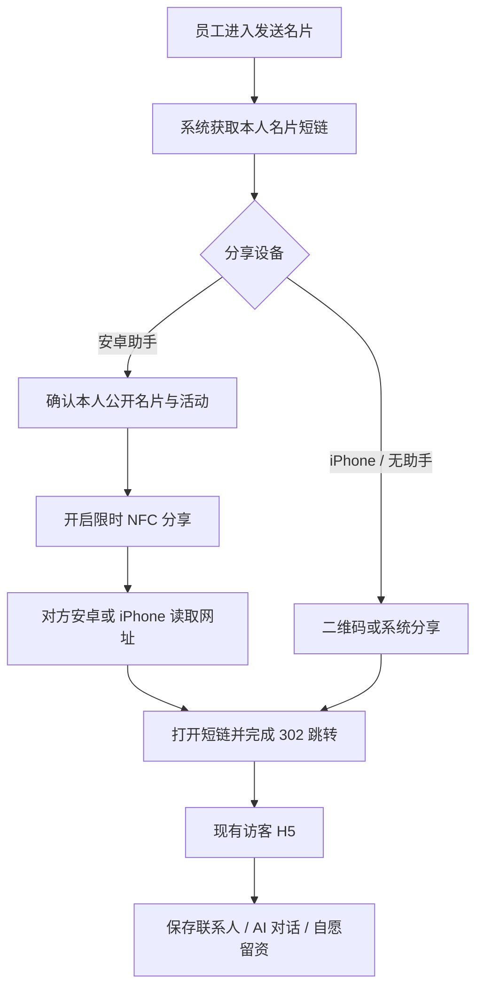

# AICardHub NFC 手机名片接入与功能补充方案

日期：2026-11-15。状态：可评审设计，未实施、未真机验收。关联决策：[ADR-006](adr/ADR-006-手机NFC分享与双端兼容.md)；任务：[NFC 开发任务包](../tasks/NFC-接入任务包.md)。

范围更新（2026-11-15）：负责人已确认安卓发送/接收、iPhone 接收，并新增安卓写 NFC 贴纸、两端读取贴纸。iPhone 发卡不纳入本期。最新派工以 [Magpie 执行包](../tasks/nfc/README.md) 为准，贴纸规范以 [写入与采购验收](../tasks/nfc/贴纸写入与采购验收.md) 为准。

## 1. 交付目标与双端边界

沿用系统生成的 HTTPS 短链，通过安卓手机模拟标签或实体 NFC 贴纸交给访客手机，再由现有短链跳转到 H5 名片。域名、短链、页面、数据均由 AICardHub 控制；手机分享不需要实体卡，同时支持后续采购的贴纸，不依赖第三方名片平台。

推荐组合：**安卓原生 NFC 分享助手 + 现有员工/访客 H5 + iPhone 二维码及系统分享**。安卓助手用 Kotlin 和 Android HCE 模拟 NFC Forum Type 4 NDEF URI 标签，优先参考 `LuigiVampa92/ndef-emulator`，不为此重写 Vue H5 或改用 React Native。

必须区分两项验收：

- 两端用户都能分享、访问名片：作为本方案的交付目标；iPhone 发送使用二维码/链接，安卓在通过机型验证后增加 NFC。
- iPhone 作为 NFC 发送端：按负责人最新确认，**不纳入本期**，不得标记已兼容。二维码通过分享验收，不用于替代 NFC 接收验收。

| 发送端 | 接收端 | 本次方案 | 验收状态 |
| --- | --- | --- | --- |
| 支持 HCE 的安卓 + 分享助手 | 支持 NFC 的安卓 | NFC URI → 短链 → H5 | 待真机验证 |
| 支持 HCE 的安卓 + 分享助手 | iPhone XS 及以后 | 读取 URI、点击系统通知 → 短链 → H5 | 待真机验证，不承诺靠近自动打开 |
| iPhone | 安卓或 iPhone | 展示二维码、系统分享、复制短链 | H5 功能需回归；不是 NFC 发送 |
| 安卓浏览器内，未安装助手 | 安卓或 iPhone | 二维码/链接；提供助手安装入口 | 浏览器不能自行执行 HCE |
| 不支持 NFC/HCE 的设备或原生鸿蒙 | 任意 | H5 二维码/链接 | 原生鸿蒙不计入 Android APK 兼容范围 |
| 安卓助手写入的实体贴纸 | 安卓或 iPhone XS 及以后 | 标准 NDEF HTTPS URI → 短链 → H5 | 待样品、批次及真机验证 |

Apple EEA HCE 文档已列出 Device-to-Device transactions，但需要地区资格和 entitlement；NFC & SE Platform 也有地区、用途、协议和授权要求。本次查询的普通用途开放地区未包含中国大陆。不能说 iPhone 永远无法发卡，也不能把这些受限 API 当作大陆版现成解决方案。海外 iOS HCE 可单独立项，取得资格后再做验证，不进入本期承诺。[S3][S4]

## 2. 仓库现状及复用位置

核查基线：`3a53cbe8c8d6648cce05404a60afd3d2f6513c57`。当前 OpenAPI SHA-256：`3EBE39CD03645B7C69558307F9E60097C4C2F9CCC98A327105CB630CDC64D4E2`。以下是源码核查结果，不是线上运行证明。

| 现有位置 | 已有能力 | 本次补充 |
| --- | --- | --- |
| `server/app/modules/workspace/router.py` | `/c/{code}` 校验名片、活动，302 保留 `s/e` 和部署子路径 | 复用；补缓存策略与回归用例 |
| 同上 `/api/v1/me/card/share` | 已支持 `s=nfc`、`e`，响应含 `short_url` | 增加不渲染图片的轻量链接接口 |
| `server/app/modules/workspace/media_service.py` | 生成短链、二维码、海报 | 抽取公共短链构造，避免 NFC 获取依赖字体和海报渲染 |
| `apps/h5/src/pages/staff/card/share.vue` | 二维码、海报、链接、活动选择 | 增加 NFC 分享入口与平台说明；现有代码固定 `s=link`，NFC 不能复用这一改写函数 |
| `apps/h5/src/pages/staff/card/index.vue` | 工作台固定显示“NFC 功能未启用” | 改为可操作的“手机分享”入口，不伪报手机硬件状态 |
| `apps/h5/src/platform/index.ts` | iOS/微信识别、复制、系统分享 | 集中实现助手唤起与环境提示 |
| `apps/h5/src/utils/app-path.ts` | 子路径、短链、vCard 地址处理 | 复用并增加 App Link 路径测试 |
| `schemas.py` / `useVisit.ts` / 统计服务 | 已有 `nfc/qr/poster/link/sig` 来源与活动归因 | 保留来源枚举；按实际分享方式填写 |
| `apps/admin/src/views/Scope.vue` | 物理 NFC 管理暂缓说明 | 保留物理卡状态，增加手机 NFC 功能范围与安装/帮助信息 |

原方案提到的 `nfc_tag`、物理卡绑定和挂失不能当作当前已实现。本次手机分享不新增虚拟卡库存，不将每次开启 NFC 登记成物理卡。

## 3. 完整访问流程

沿用现有公开入口：`{public_base_url}/c/{code}?s=nfc`，展会场景增加 `&e={campaign_id}`。`public_base_url` 必须包含正确的部署前缀，例如 `/aicardhub`；不得把它误改成网站根目录。公开短链与跳转必须使用有效 HTTPS。开发环境的 localhost 不能作为另一台手机可访问的测试地址。

NFC 使用标准 NDEF URI 记录，不使用文本记录包装网址，不把 App Link、员工登录凭据、访客 token 或自定义 App scheme 当作 NFC 内容。NFC 传送网址本身不需要网络；接收方打开在线 H5 需要网络。

## 4. 功能补充清单

### 4.1 员工端 H5：B2 工作台、B4 发送名片

1. B2 将固定“NFC 功能未启用”改为“手机分享”，链接到 B4。普通浏览器只显示环境指导，不显示“设备 NFC 已开启”。
2. B4 保留二维码、海报、链接，增加“手机 NFC”。商务/展会场景共用现有活动选择器。
3. 安卓浏览器：显示“在 NFC 助手中打开”、安装帮助、复制 NFC 链接和展示二维码。浏览器不能可靠判断是否安装助手，采用用户主动点击加手动备用入口，不把超时当作未安装证据。
4. iPhone：显示“当前 iPhone 可读取他人的 NFC 名片；发送自己的名片请使用二维码或系统分享”，提供可直接使用的按钮，不显示无效的开启开关。
5. 微信内：提供“在系统浏览器打开”的操作说明；唤起被阻止时仍可复制链接或展示二维码。
6. NFC 链接为 `s=nfc`；二维码必须为 `s=qr`；普通分享/复制对外链接为 `s=link`。活动 `e` 保留。用于配置助手的“复制 NFC 链接”单独标注，不能与对外复制按钮混用。
7. “添加到桌面”只是便捷打开 H5，不表示已安装原生助手，也不会获得 HCE 能力。

### 4.2 安卓分享助手：新增 `apps/nfc-android/`

定位为轻量伴随 App，不复制员工管理和 AI 功能。首版采用“从已登录员工 H5 导入公开短链”的流程，不额外建设安卓登录/令牌体系。

| 功能 | 具体行为 |
| --- | --- |
| 接收短链 | 首选经过验证的 HTTPS Android App Link；备用为手动粘贴。仅允许配置的自有域名、部署前缀和 `/c/{code}` 路径 |
| 核对身份 | 展示公开名片姓名、公司及活动上下文，员工确认后才能启用；公开短链可复制，不把导入行为当作身份认证 |
| 硬件检查 | 手机模拟要求 NFC + HCE；贴纸读写只要求相应 NFC 读写能力，无 HCE 不应禁用写贴纸功能 |
| 开启与关闭 | 用户主动开启，每次默认 5 分钟，可手动提前结束；切换名片或活动前结束旧会话 |
| 屏幕状态 | 首版限定 App 前台、亮屏、解锁使用。离开前台、锁屏、退出、重启进程后关闭，不承诺后台常驻或息屏可用 |
| 模拟内容 | NFC Forum Type 4、NDEF URI、标准 NDEF AID；同一 APDU 会话固定一份内容，避免读取中切换产生混合数据 |
| 超时防护 | 原生服务每次请求检查有效期和启用状态，使用单调时钟；不依赖页面倒计时触发停用。进程冷启动默认关闭 |
| 冲突提示 | 检测/解释其他 HCE 应用和默认钱包路由冲突；按前台场景请求首选服务，不要求用户把名片设置成默认支付工具 |
| 状态显示 | “已准备好”“分享已结束”“设备不支持”“请开启 NFC”；收到完整读取时可提示“链接已被读取”，不可说“对方已打开页面” |
| 备用分享 | 提供系统分享和返回 H5 二维码入口；二维码使用 `s=qr`，不得把 NFC URI 原样画成二维码后仍统计成 NFC |

每次开启前联网验证公开名片状态；离线不开始新会话。验证后员工被停用时，本地无法保证立刻获知，但服务器必须继续阻止访问停用名片的个人内容及 AI 会话。关闭手机 NFC 只停止本机发送，已经被读取的公开链接仍然存在；两者不能混同。

推荐参考 `LuigiVampa92/ndef-emulator`（Apache-2.0），冻结核验过的提交，保留许可证，检查 APDU 分段、长度、超时和状态清理，不将演示代码直接视为生产实现。手机模拟的长度上限按选定实现测试冻结；实体贴纸比较实际 NDEF 容量和编码后的字节长度，不能套用示例中的 255 字节。Android min/target SDK 和 JDK/Gradle 版本在原型验证后锁定，满足实际分发渠道要求。

新增读写器功能：模式 `idle / emulate / read / write / verify` 互斥。普通访客仍用系统 NFC 读取，无需助手；助手提供主动读取与写后回读。写入前展示员工、短链与已有内容，容量不足/只读/非 NDEF/移开标签有明确反馈；写后回读一致才显示完成。长期贴纸默认不带 e，首版不永久锁卡。详细规则见执行包的贴纸规范。

### 4.3 管理后台

- 将现有 NFC 范围说明分为“手机分享”“贴纸写入”“库存绑定/挂失”三项，分别展示真实状态、支持范围、安装包/版本/帮助入口。
- 复用已有员工停用与名片状态。V1 不增加设备注册表、远程开关、设备级撤销、手机号 NFC 绑定或可伪造的“全员 NFC 已开启”统计。
- 展示现有 NFC 来源访问、对话、线索数据。来源由链接参数提供，属于渠道归因，不是已经验证的真实碰触次数。
- 安装包和帮助地址由受控发布配置提供；本期先静态配置，不为少量发布信息新增数据库表或任意 URL 配置入口。

### 4.4 访客 H5

- 接收端无需 AICardHub App；标准网址由系统处理，具体机型以真机记录为准。
- 沿用现有名片、vCard 下载、AI 对话与留资。iPhone 的“保存联系人”走网页现有 vCard 入口，不能承诺 NFC 直接静默写通讯录。
- NFC 的读取、浏览器跳转、H5 访问、AI 对话、留资是不同事件，不合并计数。短链 302 不额外创建访问记录，避免与 H5 `/public/visits` 重复。
- 保持 ADR-003 的归因规则：归因失败不阻断正常对话；不能把别人的访客/会话数据关联给本次访问。

## 5. 接口与配置设计

以下是拟新增契约，尚未写入 OpenAPI。

### 5.1 轻量分享链接

`GET /api/v1/me/card/share-link?s=nfc&e={optional_id}`，拟 operation_id：`me_card_share_link`。

- Staff Bearer 鉴权，仅使用当前员工查自己的名片，不接受 `employee_id/card_id`。
- `s` 使用现有 Source 枚举，默认 `link`；`e` 可空且正整数，复用现有公开有效活动校验。
- 成功直接返回 `{short_url, source, campaign_id}`；`source` 为实际采用值，`campaign_id` 可为 null。
- 不生成海报或二维码文件，不依赖中文字体，不改变现有 `/me/card/share` 响应。
- 名片、账号无效或活动不可用时，遵守现有错误约定；新增错误只有在现有错误码无法表达时才走核心错误登记。
- 抽取 `media_service.create_share` 中的 URL 构造供新旧入口共用；查询编码使用可靠的 URL 构造方式；域名来自受控配置，不接受请求方任意指定目标。
- 不需要数据库迁移。后端所有者先改 schema、生成 OpenAPI，再生成前端调用，禁止手写 generated 文件。

既有 `/me/card/share?s=nfc` 可以用于原型验证，但不建议作为正式 NFC 初始化依赖，因为当前实现每次同步生成二维码和海报并可能因字体缺失失败。

### 5.2 Android App Link 导入

拟新增公开 H5 路径：`/share/nfc`（部署后包含 `/aicardhub` 前缀）。链接携带公开名片 code、可选活动 e；原生端按受信任配置构造标准短链，任何输入仍需校验。该页是导入/帮助入口，不创建访客统计。

- 仅关联这一受限路径，**不要关联 `/c/*`、`/card/*` 或整个域名**，避免访客手机上安装过助手就抢走名片网页。
- 站点域名根路径 `/.well-known/assetlinks.json` 发布包名及发布签名证书 SHA-256；它不在 `/aicardhub/.well-known/` 下。需与原站已有文件合并，不能覆盖其他应用的关联。
- 域名根路径修改属于部署任务，先准备具体变更和回归证据；未发布关联文件时，手动粘贴公开 NFC 链接仍可完成配置。
- Intent/App Link 输入只传公开 code/e，不在 URL 中传 JWT 或长期授权码；助手不嵌入可执行任意页面的 JS 原生桥。
- 浏览器识别只决定展示哪种指导，真正 HCE 支持由原生 API 检测。

### 5.3 短链与停用行为

- 保持 `/c/{code}` → `/{部署前缀}/card/{code}?s=...&e=...`，增加明确 `Cache-Control: no-store` 以避免中间跳转被长期缓存。
- 未知 code 按现有错误处理；已停用名片按现有 H5 停用展示，个人数据、vCard、聊天仍需后端拦截。
- 当前短链会验证活动有效性，失效活动可能阻止原链接跳转。V1 保留这个行为并提供用户可理解的错误页及“打开普通名片”操作（移除 e，保留 s）；不可静默伪造有效活动归因。需要验证无活动链接本身有效。
- `/share/nfc`、下载、安装说明不计作客户访问；不把启动助手或 APDU 读取量写入 `/public/visits`。

## 6. 数据和运营范围

首版无新增业务表，复用 Card、Visit、ChatSession、Lead、Campaign 和现有来源枚举。NFC 有效期及模拟状态只在手机本地维护。

首版不声称能够逐台撤销手机上已复制的公开链接。若未来需要设备注册、远程关闭、转交员工或按设备统计，应另设可撤销的分享授权/别名，与名片固定 URL 分离，再提迁移和契约；不能用公开 URL 作为身份凭证。

对外文案：“安卓手机支持 NFC 递名片，iPhone 可接收；两端均支持二维码与链接分享。”只有真机验证通过的设备才进入 NFC 支持名单。

贴纸补充文案：“使用安卓助手写入 NFC 贴纸，安卓和 iPhone 均可读取。”物理载体与手机模拟均统计为 nfc；本期不新增载体细分报表。固定员工短链不能逐贴纸挂失或免重写换人，不以 UID 冒充可撤销后台绑定。

## 7. 验收与发布门槛

### 自动化验证

1. 新旧短链构造一致，根部署与 `/aicardhub/` 部署都正确；s/e 不丢失、无双重前缀、无开放跳转。
2. 轻量接口在字体缺失时仍可用且不生成图片；使用员工 A/B 实际不同 token 验证返回各自名片；伪造外部员工参数不能获取他人私有数据。
3. 停用名片与过期活动有清楚反馈；NFC、二维码、系统分享的归因分别正确。
4. HCE 协议测试覆盖 SELECT、CC/NDEF 读取、分段读取、非法命令、超长数据、超时、停止后再读、进程冷启动、读取中切换内容。
5. H5 浏览器测试覆盖 iOS 指导、安卓唤起与失败备用、微信指导、二维码和链接；不通过浏览器模拟宣称 NFC 射频验收通过。
6. 现有后端/前端必要检查与回归通过，不放宽现有验收断言；新增 UI 附 390×844 截图。

### 真机验证

至少选三款支持 HCE 的安卓发送机，覆盖不同品牌与实际目标系统；接收端至少三款安卓、三款 iPhone（含较早 XS 或同代能力机型及较新系统设备）。按每个声称支持的发送/接收组合，亮屏解锁标准条件连续测试 20 次，记录发现、提示、点击后打开和失败原因；建议每组合不少于 19 次成功才进入首批支持名单，否则标注不支持或修复重测。此标准是验收目标，当前结果全部待测。

另外检查：NFC 关闭、设备不支持、息屏/锁屏、换卡、退出 App、进程被杀、其他 HCE/钱包冲突、接收方断网、域名证书错误、活动失效、员工停用、厚手机壳与天线位置。URL 读取成功与 H5 网络加载成功分开记录。

Android APK 使用固定包名、专用签名和可持续升级策略，发布包提供版本、哈希及许可证信息。受控小范围试点后再发布，完整项目灰度门槛仍按原计划。没有硬件和证据时，只能交付“开发候选”，不能交付“安卓/iPhone NFC 已全面兼容”。

## 8. 推进顺序与预计投入

1. 先做双安卓和安卓→iPhone 的最小短链原型，确认芯片/系统互操作：约 1–2 人日，必须有真机。
2. 原型通过后实现轻量短链接口、H5 入口和来源区分：约 1–2 人日。
3. 安卓助手正式状态控制、App Link、签名打包：约 3–5 人日。
4. 后台说明、安装指导、跨机型测试和受控试点准备：约 2–3 人日。

合计约 7–12 人日，为方案估算，不包含设备采购、应用市场审核或 Apple 授权等待。若核心跨设备验证失败，应停留在原型问题解决，不先铺开完整界面后再宣布兼容。

新增贴纸读写与异常回读验证后，完整范围参考投入调整为约 9–16 人日；实际日历时间受可并发任务、设备和样品到位影响。无样品时可继续软件开发及构建，贴纸射频验收保持待测。

## 9. 官方与开源依据

- [S1] Android HCE：<https://developer.android.com/develop/connectivity/nfc/hce>
- [S2] Apple 后台读标签：<https://developer.apple.com/documentation/corenfc/adding-support-for-background-tag-reading>
- [S3] Apple EEA HCE：<https://developer.apple.com/support/hce-transactions-in-apps/>（2026-11-15 再次读取，包含 Device-to-Device transactions）
- [S4] Apple NFC & SE Platform：<https://developer.apple.com/support/nfc-se-platform/>（2026-11-15 再次核对适用地区）
- [S5] Web NFC 不支持 HCE/P2P：<https://developer.chrome.com/docs/capabilities/nfc>
- [S6] 首选 Android 库及 demo：<https://github.com/LuigiVampa92/ndef-emulator>
- [S7] 双安卓发送/读取验证示例：<https://github.com/MichaelsPlayground/NfcHceNdefEmulator>
- [S8] Android App Links：<https://developer.android.com/training/app-links/verify-android-applinks>（实施时核对最新签名关联要求）

本方案基于本地源码和官方资料制定，没有修改业务实现、构建 APK、安装手机应用或进行线上部署。
